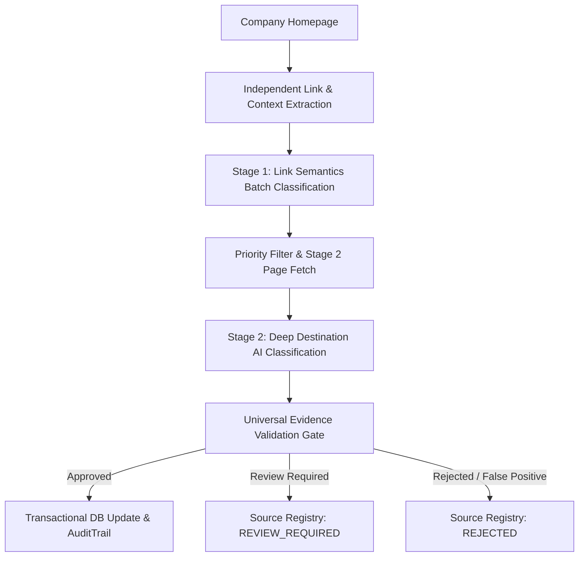

# AI-Powered Official Website Discovery, Page Classification, and Database Correction Setup Guide

This guide details the architecture, configuration, operation, scalability design, and provider extensibility for the AI-powered official website discovery and page classification system for the **CSR & Job Intelligence Platform**.

---

## 1. Architecture Overview

The system automates the discovery, semantic classification, evidence validation, and transactional synchronization of corporate web assets:
- **Careers & Recruitment**: `careers_url`, `jobs_page_url`, ATS platform integration (`ats_platform`, `ats_url`).
- **Corporate Social Responsibility & ESG**: `csr_page_url`, `sustainability_page_url`.
- **Public Disclosures**: Annual reports with Section 135 disclosures, CSR policy documents, partnership RFPs.

### Two-Stage Classification Pipeline



1. **Stage 1 — Discovered Links & Semantics**:
   - Independent crawler extracts candidate links and structural context (`NAV_HEADER`, `FOOTER_NAV`, `BODY_CONTENT`, etc.) from the company homepage.
   - Evaluates link semantics in compact batches via the active AI provider.
   - Classifies links into broad categories (`CAREERS_RECRUITMENT`, `CSR_SOCIAL_IMPACT`, `SUSTAINABILITY_ESG`, `REPORTS_PUBLICATIONS`) and specific candidate types.
2. **Stage 2 — Content Retrieval & Deep Destination Classification**:
   - Fetches destination pages using the HTTP client / Playwright fallback.
   - Extracts page titles, structured headings, bounded text chunks, ATS identifiers, job vacancy cards, and Section 135 statutory indicators.
   - Submits structured JSON requests to the AI classifier.
3. **Independent Evidence-Validation Gate**:
   - **Provider-Independent**: Validates predictions using strict factual rules regardless of which AI provider is configured.
   - **Rejects customer-facing commercial applications** (e.g., loan applications labeled "Apply Now").
   - **Rejects generic partnership pages** unless backed by documented RFPs, grants, or tenders.
   - Preserves existing approved URLs if confidence or evidence is below calibrated thresholds.
4. **Source Registry & Audit Trail**:
   - Discovered sources are tracked in the normalized `company_source_registry` (`CompanySource` model).
   - Only `APPROVED` sources update primary `Company` fields within `transaction.atomic()`.
   - Every change creates an immutable record in `audit_trail` (`AuditTrail` model).

---

## 2. Active AI Architecture: Gemini Primary (Free Tier) + Grok Fallback (Zero-Cost Only)

The platform is configured with a **strict zero-cost requirement**:
- **Primary AI Classifier**: Google Gemini (official API free tier only).
- **Fallback AI Classifier**: xAI Grok (enabled only if confirmed, usable, non-billable API credits exist).

### Core Zero-Cost Principles
1. **Gemini Free Tier Only**: Accessible exclusively via models confirmed in Google's official API free tier (`gemini-2.5-flash`, `gemini-1.5-flash`, `gemini-2.0-flash`, `gemini-1.5-flash-8b`). Non-free models are blocked by `ZeroCostPolicyViolationError`.
2. **Grok Strict Zero-Cost Policy**:
   - **Web/App Account Disclaimer**: Having a free or paid Grok web/app account (e.g. on X / grok.com) does **NOT** provide free API usage on `api.x.ai`.
   - **Confirmed Credits Guard**: `GROK_FREE_CREDITS_CONFIRMED=true` is required for any Grok fallback call. If unconfirmed or missing, Grok requests are strictly blocked.
   - **Never Automatic Billing**: The platform will NEVER activate billing, purchase credits, or switch to paid models.
3. **Safe Checkpointing on Quota Exhaustion**:
   - When Gemini reaches its quota (`HTTP 429` / `RESOURCE_EXHAUSTED`) and Grok cannot be used for free, the platform gracefully pauses execution, persists all completed companies to `.checkpoints/discovery_checkpoint.json`, and preserves unclassified candidate sources with status `PENDING_AI` or `REVIEW_REQUIRED`.
   - Existing approved company URLs are NEVER overwritten with uncertain data.

### Configuration Settings (`ai_classifier_config.py` & `.env`)

```env
# AI Provider Configuration
AI_PROVIDER=gemini
AI_FALLBACK_PROVIDER=grok
AI_FALLBACK_ENABLED=true

# Google Gemini (Primary Free Tier)
GEMINI_MODEL=gemini-2.5-flash
GEMINI_API_KEY=your-gemini-api-key-here
# Available free-tier models: gemini-2.5-flash, gemini-1.5-flash, gemini-2.0-flash, gemini-1.5-flash-8b

# xAI Grok (Fallback Zero-Cost Guard)
GROK_MODEL=grok-2-latest
GROK_API_KEY=your-xai-api-key-here
GROK_ZERO_COST_ONLY=true
GROK_FREE_CREDITS_CONFIRMED=false

# Operational Flags
AI_CLASSIFICATION_ENABLED=true
AI_DRY_RUN=true
AI_CACHE_ENABLED=true
MAX_API_CALLS_PER_RUN=50
```

### Non-Billable Eligibility Verification Command

To test both provider configurations without incurring any API charges or token consumption:
```bash
python manage.py test_ai_providers
```
This command performs non-billable metadata probes against Google and xAI endpoints and reports real-time eligibility under the zero-cost policy.

---

## 3. Pluggable Architecture: Replacing OpenRouter in the Future

The crawler, page-classification logic, evidence gate, scraping pipeline, and database layer are 100% decoupled from OpenRouter.

### Adding a Future Provider Adapter

To configure a new AI provider (e.g., Anthropic Claude, OpenAI, Ollama, or custom internal model), follow these 3 steps without modifying any scraping or crawling logic:

#### Step 1: Create Provider Adapter Subclassing `BaseAIClient`

In `modules/crawler_engine/ai_api_client.py` (or a dedicated provider module):

```python
from modules.crawler_engine.ai_api_client import BaseAIClient, AIProviderRegistry

class AnthropicApiClient(BaseAIClient):
    """Adapter for Anthropic Claude models."""

    def __init__(self):
        super().__init__()
        self.api_key = os.getenv("ANTHROPIC_API_KEY")
        self.model = os.getenv("ANTHROPIC_MODEL", "claude-3-5-sonnet-20241022")

    def _execute_provider_request(self, prompt: str) -> Tuple[Any, str]:
        # Perform Anthropic API call with messages format
        # Return tuple: (parsed_json_data, actual_model_name)
        ...
```

#### Step 2: Register in `AIProviderRegistry`

```python
AIProviderRegistry.register("anthropic", AnthropicApiClient)
```

#### Step 3: Switch in `.env`

```env
AI_PROVIDER=anthropic
ANTHROPIC_API_KEY=sk-ant-api03-...
ANTHROPIC_MODEL=claude-3-5-sonnet-20241022
```

The system will automatically instantiate `AnthropicApiClient`. All Stage 1 prompts, Stage 2 prompts, evidence validation rules, disk caching, and database updates will operate seamlessly.

---

## 4. Scalable Company Processing (1,000+ Companies)

The system treats the current 201 companies as the initial dataset, **not a hardcoded limit**. It is architected to scale beyond 1,000+ companies through:

1. **Memory-Bounded Query Streaming**:
   - Queries use `.only(...)` to load only essential URL and domain fields.
   - Iterates using `Company.objects.all().order_by('company_id').iterator(chunk_size=batch_size)` (default chunk size: 50).
   - Python RAM consumption remains $O(1)$ regardless of table size.
2. **Persistent Classification Caching (`PersistentDiskCache`)**:
   - Stores classification responses in SQLite at `.cache/ai_classifier/ai_cache.sqlite3`.
   - Cache keys hash: `{provider}:{model}:{prompt_version}:{stage}:{content_hash}`.
   - Prevents redundant API requests when identical link sets or pages are encountered.
3. **Source-Content Hash Skipping**:
   - Computes SHA-256 hash of company homepages and destination pages.
   - If a company's content hash matches the previously verified baseline, reclassification is bypassed (`UNCHANGED_SKIPPED`), saving API quota.
4. **Resumable Checkpointing**:
   - Persists state to `.checkpoints/discovery_checkpoint.json` after every single company.
   - Separately tracks:
     - `completed_companies`: Successfully classified and approved.
     - `inaccessible_companies`: Domain unreachable or 404/5xx error.
     - `review_required_companies`: Ambiguous or below confidence threshold.
     - `unchanged_skipped_companies`: Skipped via content-hash match.
     - `error_companies`: Unexpected exceptions.
5. **Idempotent Updates & Review Safety**:
   - Uncertain source URLs (`REVIEW_REQUIRED`) are recorded in `CompanySource` with `is_primary=False` and **never** overwrite verified `Company` URLs.
   - Approved updates are wrapped in `transaction.atomic()` with audit trails and older sources marked `SUPERSEDED`.

---

## 5. CLI Usage & Management Commands

### Dry Run (Read-Only Preview)
Simulates discovery and classification across all companies without modifying the database:
```bash
uv run python manage.py discover_and_verify_company_sources --all --dry-run
```

### Production Execution (Apply Verified Updates)
Updates primary company URLs, updates the source registry, and generates audit logs:
```bash
uv run python manage.py discover_and_verify_company_sources --all --apply-verified-updates
```

### Resuming After Quota Pause
Resumes processing, automatically skipping previously completed and unchanged companies:
```bash
uv run python manage.py discover_and_verify_company_sources --resume --apply-verified-updates
```

### Scalable Batching Options
```bash
# Process in batches of 100 with a custom API call budget
uv run python manage.py discover_and_verify_company_sources --batch-size 100 --max-api-calls 150 --apply-verified-updates

# Force reclassification (ignore content-hash skip)
uv run python manage.py discover_and_verify_company_sources --force-reclassify --limit 10

# Retry previously inaccessible companies
uv run python manage.py discover_and_verify_company_sources --resume --retry-inaccessible
```

---

## 6. Acceptance Testing

Run the formal acceptance test suite covering all 10 mandatory architecture requirements:

```bash
uv run python manage.py test tests.test_ai_architecture_requirements tests.test_ai_page_classifier
```

| # | Acceptance Criterion | Test Method | Status |
|---|---|---|---|
| 1 | OpenRouter free router is sole active provider | `test_01_openrouter_free_is_only_active_provider` | **PASS** |
| 2 | No automatic fallback to paid/alternative models | `test_02_no_automatic_fallback_to_paid_or_alternative_providers` | **PASS** |
| 3 | Dynamic querying of company directory | `test_03_processes_company_directory_dynamically` | **PASS** |
| 4 | Adding new companies requires no code changes | `test_04_adding_new_company_records_requires_no_code_changes` | **PASS** |
| 5 | Resumption from checkpoint after quota pause | `test_05_resumption_from_checkpoint_skips_completed_companies` | **PASS** |
| 6 | Results reused when source content unchanged | `test_06_persistent_cache_and_content_hash_reuse` | **PASS** |
| 7 | Scales beyond 1,000 companies via streaming batch | `test_07_scales_past_1000_companies_with_bounded_memory` | **PASS** |
| 8 | Pluggable provider adapter architecture | `test_08_pluggable_ai_provider_registry` | **PASS** |
| 9 | Uncertain URLs flagged for review without overwriting | `test_09_uncertain_urls_flagged_for_review_without_overwriting_primary_urls` | **PASS** |
| 10 | Backups, audit logging and atomic safety | `test_10_backups_audit_logging_and_transactional_safety` | **PASS** |
