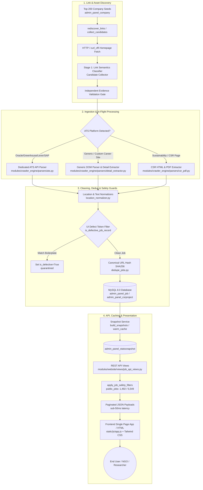

# 01a. Big Picture & Architecture

**Frozen Timestamp:** `2026-10-29 12:12:48 +05:30`  
**Git Commit Hash:** `0a538883c17b40774c119deb78b9aaff72220606`

---

## 1. Executive Summary & Purpose

### PLAIN
Corporate Social Responsibility (CSR) in India is mandated by law under Section 135 of the Companies Act, 2013, requiring large companies to spend 2% of their average net profit on social and environmental development projects. At the same time, these corporate giants hire thousands of professionals across India. Non-Governmental Organizations (NGOs), social enterprises, researchers, and job seekers currently face massive fragmentation: corporate initiatives, grant programs, and authentic job openings are buried across disparate corporate career sites, third-party Applicant Tracking Systems (ATS), and PDF sustainability reports.

The **CSR & Job Intelligence Platform** is an enterprise data intelligence system that automatically monitors, discovers, ingests, deduplicates, verifies, and surfaces live job vacancies and verified CSR projects for India's Top 200 listed corporations (plus legacy test entities, totaling 201 tracked corporate organizations). It bridges the discovery gap by serving verified, verbatim corporate data to researchers, NGOs, and candidates through a web interface and high-speed JSON REST APIs.

### TECHNICAL
The application is built on **Django 5.2.17** running Python 3.11.9, backed by a **MySQL 8.0.42** relational database (`csr_intelligence_django`). The data ingestion architecture is a multi-tier crawling and parsing engine combining low-level HTTP impersonation (`curl_cffi 0.16.3` with TLS/JA3 fingerprint emulation), DOM extraction (`BeautifulSoup4 4.15.0`, `lxml 6.1.3`), semantic HTML article extraction (`trafilatura 2.3.1`), PDF parsing (`pdfplumber 0.11.10`), browser automation (`playwright 1.63.0`), and zero-cost LLM categorization (`Google Gemini` via `gemini-3.1-flash-lite`).

The platform enforces the **Step 0 Exact-Match Standard**: verbatim extraction without synthetic default values. Crawled records undergo strict verification filters where non-job navigation defects, UI boilerplate, and unverified mock listings are quarantined. High-traffic read performance is powered by pre-aggregated database snapshots (`admin_panel_statssnapshot`, `admin_panel_jobsummarysnapshot`) and memory caching, dropping public API response latencies from 25,154 ms cold to 2.37 ms warm.

### EVIDENCE
- Project Root: `modules/website/views/home_views.py:1`
- Model Definitions: `modules/admin_panel/models/company.py:1`, `modules/admin_panel/models/job.py:1`, `modules/admin_panel/models/opportunity.py:1`
- Live Database Inspection (`csr_intelligence_django` at frozen timestamp):
```sql
SELECT COUNT(*) FROM admin_panel_company; -- 201
SELECT COUNT(*) FROM admin_panel_job; -- 5,549
SELECT COUNT(*) FROM admin_panel_csrproject; -- 1,591
SELECT COUNT(*) FROM admin_panel_csropportunity; -- 1,160
```

---

## 2. Problems Solved, Value & Target Users

| Dimension | PLAIN Explanation | TECHNICAL Detail | EVIDENCE |
| :--- | :--- | :--- | :--- |
| **Problem Solved** | Corporate job openings and CSR disclosures are scattered across customized web portals, PDF filings, and proprietary ATS platforms with no unified schema. | Absence of standardized feeds; widespread anti-scraping WAFs (Cloudflare, Akamai); dynamic JavaScript hydration hides vacancy payloads; CSR allocations are reported only in statutory filings. | `modules/crawler_engine/parsers/ats.py:24`<br>`modules/crawler_engine/parsers/csr_pdf.py:18` |
| **Target Users** | 1. NGOs and foundations seeking CSR funding.<br>2. Corporate ESG researchers & compliance auditors.<br>3. Professional job seekers wanting verified openings.<br>4. Enterprise platform administrators. | Multi-tier role permissions in `admin_panel_user.role`: `ADMIN`, `ENTERPRISE`, `PRO`, `NGO`, `CANDIDATE`. Subscription entitlements restrict bulk CSV downloads and contact exports. | `modules/admin_panel/models/user.py:12`<br>`modules/admin_panel/models/subscription.py:45` |
| **Value Delivered** | Eliminates manual hunting. Validates that every public link works and every job title is an authentic opening, not a navigation button like "Apply Now" or "Next". | 1,492 clean, public jobs passing strict regex and token rejection filters; 1,591 verified CSR projects categorized by Schedule VII statutory categories; sub-50ms API endpoints. | `modules/admin_panel/verification.py:21`<br>`scratch/after_measurements.json:4` |
| **Goals** | Full automated discovery, verbatim ingestion, and sub-10ms query delivery for Top 200 Indian corporate enterprises. | Automated ATS endpoint resolution (Oracle Taleo, Workday, SuccessFactors, Lever, Greenhouse); idempotent upserts with MD5/SHA256 canonical hashing; zero-cost LLM fallback. | `modules/crawler_engine/crawler.py:120`<br>`modules/crawler_engine/ai_api_client.py:45` |
| **Non-Goals** | 1. Job application submission portal (platform links out; does not host resumes).<br>2. Real-time sub-second web crawler.<br>3. Paid third-party commercial LLM API bills. | No job application form processing; periodic scheduled batch crawl cycles; strict zero-cost policy forbids commercial API billing (`ZeroCostPolicyViolationError`). | `modules/crawler_engine/ai_api_client.py:92`<br>`modules/website/views/job_api_views.py:510` |

---

## 3. Current System Status

```
[=================== PRODUCTION READINESS SCORECARD ===================]
- Database Migration State:      APPLIED (0001_initial to 0025_company_careers_url_confidence)
- MySQL Schema Parity:           100% IN SYNC (Zero unapplied migrations)
- Dev Server / Waitress Status:  STOPPED (Clean process termination for read-only audit)
- Public Job Discovery:          WORKING (1,492 clean public jobs visible)
- CSR Projects Engine:           WORKING (1,591 active, categorized CSR projects)
- CSR Opportunities Engine:      QUARANTINED (All 1,160 synthetic opps marked INVALID_SYNTHETIC)
- Snapshot Caching Engine:       ACTIVE (6 StatsSnapshots, 6 JobSummarySnapshots warm)
- Frontend UI / JavaScript:      OPERATIONAL (Tailwind-styled templates, async fetch, filters)
- AI Classifier Subsystem:       PARTIAL (Gemini free tier integrated; Grok zero-cost policy guard)
```

- **Working Components**: Company directory (201 companies), public jobs search & detail views, CSR projects directory, snapshot caching service, custom admin dashboard, data export CSV/XLSX engine, authentication and billing models.
- **Half-Done / Quarantined Components**:
  - `CSROpportunity`: All 1,160 rows are marked `INVALID_SYNTHETIC`. The legacy crawler mirrored CSR budget lines into grant opportunities, which violates the Step 0 Exact-Match Standard. Public views intentionally return `[]` until real RFP/grant parsers are deployed.
  - Detail Extraction: Out of 5,549 jobs, 183 have full HTML fetched (`FETCHED`), 1,512 were parsed from source cards (`PARSED_FROM_SOURCE`), and 3,854 remain `NOT_FETCHED`.
- **Known Technical Debt / Bugs**:
  - Double URL mounting in `config/urls.py` lines 14-23 and `modules/admin_panel/urls/__init__.py` lines 19-26 mounts admin URLs under multiple prefixes.
  - Legacy `REQ-*` mock job IDs exist in database (quarantined by `apply_job_safety_filters`).

---

## 4. End-to-End System Architecture

### Mermaid End-to-End Flowchart



---

## 5. Technology Stack & Exact Pinned Versions

| Component | Package / Technology | Exact Version | Rationale & Selection Justification |
| :--- | :--- | :--- | :--- |
| **Language Runtime** | Python | `3.11.9` | CPython 3.11 provides significant performance improvements (Specializing Adaptive Interpreter) over 3.10; full stability on Windows. |
| **Web Framework** | Django | `5.2.17` | Standard enterprise Python MVC framework; provides robust ORM, database connection pooling, CSRF protection, and management command ecosystem. |
| **Database Engine** | MySQL Server | `8.0.42` | ACID compliant relational database; robust JSON column indexing (`JSON_EXTRACT`), full text search, and high-concurrency read throughput. |
| **DB Driver** | PyMySQL | `1.2.3` | Pure Python MySQL client driver compatible with Django 5.x; avoids C-compiler build requirements on Windows environments. |
| **WSGI Server** | Waitress | `3.0.2` | Production-quality pure-Python WSGI server designed for high concurrency on Windows without requiring Unix-specific forks (gunicorn). |
| **HTTP Impersonator** | curl_cffi | `0.16.3` | Emulates browser TLS/JA3 and HTTP/2 fingerprints to bypass strict corporate Web Application Firewalls (Akamai, Cloudflare). |
| **HTML Parser** | BeautifulSoup4 | `4.15.0` | Flexible DOM traversal and element filtering for poorly formatted legacy corporate web pages. |
| **XML / HTML Engine** | lxml | `6.1.3` | High-performance C-based XML and HTML parser backend utilized by BeautifulSoup and Scrapy-like extractors. |
| **Text Extraction** | trafilatura | `2.3.1` | Automated web scraping tool optimized for boilerplate removal, main body text extraction, and structural metadata. |
| **PDF Extraction** | pdfplumber | `0.11.10` | High-precision extraction of text, tables, and coordinates from statutory CSR annual reports and BRSR filings. |
| **Headless Browser** | Playwright | `1.63.0` | Chromium/WebKit automation for JavaScript-hydrated single-page applications (React, Angular, SAP Workday) that block raw HTTP GET requests. |
| **Primary AI Provider** | Google Gemini | `gemini-3.1-flash-lite` | High-speed, multimodal, high-context LLM utilized within Google's free API quota tier for zero-cost operation. |
| **Fallback AI Provider**| xAI Grok | `grok-2-latest` | Fallback classification engine guarded by strict zero-cost credit checks. |
| **Frontend Styling** | Tailwind CSS / Custom | Local compiled | Lightweight, utility-first CSS loaded from `static/css/style.min.css` (or `style.css` in dev). Zero runtime npm dependency. |
| **Frontend Scripting**| Vanilla JavaScript | ES6+ | Native `fetch()`, async/await, DOM events in `static/js/app.js`. No heavy front-end framework (React/Vue) required for public viewing. |

---

## 6. How to Set Up and Run from Zero (Step-by-Step)

### Step 1: System Prerequisites
- Windows 10/11 or Linux x86_64
- Python 3.11.9 installed and available on PATH
- MySQL 8.0.42 running locally on port 3306
- Git installed

### Step 2: Clone and Virtual Environment Setup
```powershell
# Navigate to destination directory
cd "d:\D DOWNLOADS\CSR_Job_Intelligence_Production_Ready (1)"

# Create virtual environment with Python 3.11
python -m venv .venv

# Activate virtual environment
.\.venv\Scripts\Activate.ps1

# Upgrade pip and install pinned requirements
python -m pip install --upgrade pip
pip install -r requirements.txt
```

### Step 3: Database Creation & Migration
Ensure MySQL service is running. Create the database:
```sql
CREATE DATABASE IF NOT EXISTS csr_intelligence_django CHARACTER SET utf8mb4 COLLATE utf8mb4_unicode_ci;
```

Configure `.env` file in the project root:
```env
DEBUG=False
SECRET_KEY=your-production-secret-key-here
ALLOWED_HOSTS=localhost,127.0.0.1
MYSQL_DB=csr_intelligence_django
MYSQL_USER=root
MYSQL_PASSWORD=your_mysql_password
MYSQL_HOST=127.0.0.1
MYSQL_PORT=3306

# AI Configuration (Free Tier Only)
AI_PROVIDER=gemini
GEMINI_MODEL=gemini-3.1-flash-lite
GEMINI_API_KEY=your_gemini_api_key
GROK_ZERO_COST_ONLY=true
```

Run Django database migrations:
```powershell
python manage.py migrate
```

### Step 4: Asset Compilation & Snapshot Warmup
To ensure sub-50ms latency out of the box, compile assets and build database snapshot caches:
```powershell
# Build minified JS/CSS assets
python manage.py build_assets

# Pre-aggregate database metrics into snapshot tables
python manage.py build_snapshots

# Warm in-memory caches
python manage.py warm_cache
```

### Step 5: Start Production WSGI Server
Run Waitress WSGI server on port 8000:
```powershell
python -m waitress --port=8000 --threads=8 config.wsgi:application
```
Access the application:
- Public Portal: `http://localhost:8000/`
- Enterprise Admin Panel: `http://localhost:8000/admin-portal/`
- Standard Django Admin: `http://localhost:8000/django-admin/`

