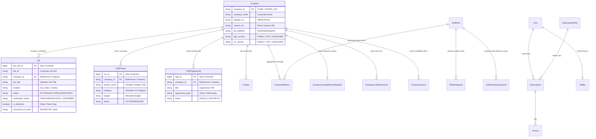

# 02a. Data Model: Core Entities (Company, Job, Snapshots & Telemetry)

**Frozen Timestamp:** `2026-10-29 12:12:48 +05:30`  
**Git Commit Hash:** `0a538883c17b40774c119deb78b9aaff72220606`

---

## 1. Entity-Relationship Architecture

### PLAIN
The database stores three primary kinds of information: corporate organizations (the Top 200 Indian companies), authentic career openings found on their websites, and statutory social welfare projects mandated by law. Around these core records sit snapshot caches that make the website load instantly, telemetry registers that track crawl health, and audit trails that record every edit.

### TECHNICAL
The relational database `csr_intelligence_django` comprises **42 tables** managed by Django ORM under InnoDB with `utf8mb4_unicode_ci` collation. `Company` acts as the root parent entity referenced via foreign keys with `CASCADE` or `PROTECT` semantics. High-volume entities like `Job` incorporate single and composite B-tree indexes, along with a dedicated SHA-256 canonical hash index (`canonical_url_hash`) for deduplication. Snapshot models (`StatsSnapshot`, `JobSummarySnapshot`) serialize large aggregated pre-calculated querysets into JSON payloads.

### Mermaid ER Diagram



---

## 2. Table Summary & Frozen Row Counts

Taken at frozen timestamp `2026-10-29 12:12:48 +05:30`:

| Table Name | Model Class | Row Count | Primary Purpose |
| :--- | :--- | :--- | :--- |
| `admin_panel_company` | `Company` | **201** | Master record for Top 200 Indian companies + 1 legacy test entity |
| `admin_panel_job` | `Job` | **5,549** | Raw, verified, and quarantined corporate job postings |
| `admin_panel_csrproject` | `CSRProject` | **1,591** | Real corporate social responsibility initiatives and statutory filings |
| `admin_panel_csropportunity` | `CSROpportunity` | **1,160** | CSR partnerships / grants (100% marked INVALID_SYNTHETIC) |
| `admin_panel_companymetrics` | `CompanyMetrics` | **1,206** | Historic coverage scores and counts per audit run |
| `admin_panel_contact` | `Contact` | **41** | Verified corporate CSR, HR, and governance contacts |
| `company_completeness_register` | `CompanyCompletenessRegister` | **201** | Five-point completeness audit per corporate entity |
| `company_crawl_summary` | `CompanyCrawlSummary` | **139** | Per-crawl execution telemetry and sync stats |
| `admin_panel_statssnapshot` | `StatsSnapshot` | **6** | Pre-calculated JSON payloads for `/stats` public API |
| `admin_panel_jobsummarysnapshot` | `JobSummarySnapshot` | **6** | Pre-calculated JSON payloads for `/jobs/summary` public API |
| `admin_panel_auditrun` | `AuditRun` | **6** | Audit run metadata coordinating snapshots and defect versions |
| `audit_trail` | `AuditTrail` | **8,391** | Immutable field-level provenance audit log |
| `pages` | `Page` | **513** | Scraped corporate web pages (Careers, CSR, ESG, PDFs) |
| `ai_provider_config` | `AIProviderConfig` | **10** | Provider credentials and configuration records |
| `ai_system_settings` | `AISystemSettings` | **1** | Primary/fallback routing rules and zero-cost policy toggles |
| `ai_configuration_audit_log` | `AIConfigurationAuditLog` | **19** | Audit log for AI provider changes |
| `subscription_plans` | `SubscriptionPlan` | **4** | Billing tiers (Starter, Pro, Enterprise, Foundation) |
| `subscriptions` | `Subscription` | **2** | Active tenant subscription instances |
| `invoices` | `Invoice` | **7** | Billing invoices generated for subscriptions |
| `payments` | `Payment` | **19** | Payment gateway transaction records |
| `wallets` | `Wallet` | **2** | Tenant wallet balances for micro-metered API usage |
| `wallet_transactions` | `WalletTransaction` | **13** | Credits/debits against tenant wallets |
| `usage_counters` | `UsageCounter` | **6** | Metered API and feature usage counters per period |
| `promo_codes` | `PromoCode` | **6** | Discount codes for subscription checkouts |
| `subscription_events` | `SubscriptionEvent` | **27** | Lifecycle events (plan upgrades, cancellations) |
| `subscription_plan_entitlements` | `SubscriptionPlanEntitlement` | **38** | Granular feature flags and quotas per plan |
| `admin_panel_user` | `User` | **2** | Custom user accounts (1 superuser admin, 1 test user) |
| `django_session` | `Session` | **122** | Django session storage records |
| `django_migrations` | `Migration` | **43** | Applied Django migrations tracking table |
| `django_content_type` | `ContentType` | **38** | Internal Django content types registry |
| `auth_permission` | `Permission` | **152** | Django auth permission registry |
| *Empty Tables (0 rows)* | *Various* | **0** | `admin_panel_document`, `admin_panel_ngocollaboration`, `admin_panel_opportunityscore`, `admin_panel_prospect`, `admin_panel_servicecatalog`, `company_source_registry`, `django_admin_log`, `auth_group`, `auth_group_permissions`, `admin_panel_user_groups`, `admin_panel_user_user_permissions` |

---

## 3. Core Model: Company (`admin_panel_company`)

### PLAIN
The Company model represents a large corporate entity in India. It stores legal identity (name, stock ticker, listing status), web presence (official homepage, direct careers site, CSR sustainability portal), and flags controlling whether its data may be shown to the public.

### TECHNICAL
- **File & Class**: `modules/admin_panel/models/company.py:12` (`Company`)
- **Primary Key**: `company_id` (varchar 50). Values follow the pattern `COMP_TOP200_001` through `COMP_TOP200_200`, plus `COMP_001` (1 test entity). Total: 201 rows.
- **Table Name**: `admin_panel_company`
- **Relations**: Reverse relation `jobs` (1:N to `Job`), `csr_projects` (1:N to `CSRProject`), `opportunities` (1:N to `CSROpportunity`), `contacts` (1:N to `Contact`), `metrics` (1:N to `CompanyMetrics`), `completeness` (1:1 to `CompanyCompletenessRegister`).
- **Managers / Querysets**: Default `Company.objects`.
- **Signals**: Post-save signal `invalidate_company_caches` in `modules/admin_panel/signals.py:12` flushes Redis/Django cache keys upon company updates.

### Field Inventory & Data Provenance

| Field Name | Type | Null/Blank | Default | Choices / Constraints | Value Origin & Code Path |
| :--- | :--- | :--- | :--- | :--- | :--- |
| `company_id` | CharField(50) | No / No | None | Unique, Primary Key | Seeded from Top 200 Indian corporate list via `import_existing_data.py:45`. |
| `company_name` | CharField(255)| No / No | None | Indexed | Seeded from official NSE/BSE corporate filings. |
| `legal_name` | CharField(255)| Yes / Yes | None | None | Seeded from MCA / ROC company master data. |
| `isin` | CharField(20) | Yes / Yes | None | None | Seeded from NSE/BSE securities data. |
| `nse_symbol` | CharField(20) | Yes / Yes | None | None | Seeded; e.g., `TCS`, `RELIANCE`, `INFY`. |
| `bse_scrip_code`| CharField(20) | Yes / Yes | None | None | Seeded; e.g., `532540`. |
| `listing_status`| CharField(50) | No / No | 'ACTIVE' | None | Defaulted / Seeded (`ACTIVE`: 201). |
| `website_url` | URLField(500) | No / No | None | None | Seeded, cross-checked by `verify_company_homepages.py:80`. |
| `careers_url` | URLField(1000)| Yes / Yes | None | None | Discovered by `rediscover_links.py:120` or seeded. (201/201 present). |
| `csr_portal_url`| URLField(1000)| Yes / Yes | None | None | Discovered by `rediscover_links.py:150` or seeded. (201/201 present). |
| `ats_platform` | CharField(100)| Yes / Yes | None | Choices (Oracle, etc.) | Detected in-flight by `crawler.py:410` and `page_classifier.py:65`. |
| `ats_url` | URLField(1000)| Yes / Yes | None | None | Extracted direct ATS endpoint if distinct from careers page. |
| `jobs_access` | CharField(20) | No / No | 'PUBLIC' | `PUBLIC`, `NOT_PUBLISHED`| Set by `set_company_access.py:35` or crawler access detector. |
| `csr_access` | CharField(20) | No / No | 'PUBLIC' | `PUBLIC`, `NOT_PUBLISHED`, `LOGIN_REQUIRED` | Set by access detector or administrative override. |
| `contacts_access`| CharField(20)| No / No | 'PUBLIC' | `PUBLIC`, `NOT_PUBLISHED`| Administrative access flag (`PUBLIC`: 201). |
| `sync_status` | CharField(50) | No / No | 'PENDING' | `LIVE_VERIFIED`, `PENDING` | Updated by `live_syncer.py:50` (`LIVE_VERIFIED`: 201). |
| `crawl_status`| CharField(50) | No / No | 'PENDING' | Choices | Written by `crawl_all_companies.py:210`. |
| `careers_url_confidence` | FloatField | No / No | 0.0 | None | Written by `rediscover_links.py:195` (Confidence score 0.0 to 1.0). |

### Group BY Distributions & Null Rates (EVIDENCE)

```sql
-- Company Access Breakdown
SELECT jobs_access, COUNT(*) FROM admin_panel_company GROUP BY jobs_access;
-- PUBLIC: 48, NOT_PUBLISHED: 153

SELECT csr_access, COUNT(*) FROM admin_panel_company GROUP BY csr_access;
-- PUBLIC: 144, NOT_PUBLISHED: 55, LOGIN_REQUIRED: 2

-- Crawl Status Breakdown
SELECT crawl_status, COUNT(*) FROM admin_panel_company GROUP BY crawl_status;
-- PENDING: 144, CRAWLED: 32, SUSPECT_DROP: 18, FAILED: 5, BLOCKED: 2

-- ATS Platform Breakdown
SELECT ats_platform, COUNT(*) FROM admin_panel_company GROUP BY ats_platform;
-- NULL: 196, ORACLE_TALEO: 2, GREENHOUSE: 1, SUCCESSFACTORS: 1, LEVER: 1
```

---

## 4. Core Model: Job (`admin_panel_job`)

### PLAIN
The Job model represents an individual vacancy discovered on a company's career portal or ATS. It captures verbatim titles, job descriptions, work arrangements (such as On-site or Hybrid), location details, and direct application links. Because web crawlers frequently scrape page navigation elements by mistake (e.g., buttons labeled "Click Here"), this model includes defect flags that quarantine corrupt data so only genuine job vacancies are shown on the website.

### TECHNICAL
- **File & Class**: `modules/admin_panel/models/job.py:15` (`Job`)
- **Primary Key**: `job_row_id` (BigAutoField, auto-increment integer).
- **Secondary Key**: `job_id` (CharField 100, non-unique historical requisition identifier).
- **Deduplication Key**: `canonical_url_hash` (CharField 64, unique index, SHA-256 of normalized apply URL).
- **Relations**: `company` (`ForeignKey(Company, on_delete=models.CASCADE, related_name='jobs')`).
- **Indexes**: Composite index on `(company, is_defective, status)`, index on `status`, index on `canonical_url_hash`, index on `posted_date`.
- **Meta Options**: `ordering = ['-posted_date', '-job_row_id']`.

### Field Inventory & Data Provenance

| Field Name | Type | Null/Blank | Default | Purpose & Code Path |
| :--- | :--- | :--- | :--- | :--- |
| `job_row_id` | BigAutoField | No / Auto | Auto | Surrogate primary key ensuring unique row identity across all imports. |
| `job_id` | CharField(100) | No / No | None | Extracted corporate job code or synthetic hash from `crawler.py:650`. |
| `company_id` | CharField(50) | No / No | None | Foreign key referencing `admin_panel_company.company_id`. |
| `job_title` | CharField(255) | No / No | None | Normalized title string cleaned by `location_normalizer.py:80`. |
| `raw_title` | TextField | Yes / Yes | None | Verbatim unmutated title scraped directly from DOM (`Step 0 Standard`). |
| `location` | CharField(255) | Yes / Yes | None | Cleaned city/state string from `location_normalizer.py:110`. Rate: 0 empty. |
| `raw_location` | TextField | Yes / Yes | None | Verbatim unmutated location string from source HTML (`crawler.py:680`). |
| `department` | CharField(100) | Yes / Yes | None | Functional category. Empty rate: 301 / 5,549. |
| `raw_department`| TextField | Yes / Yes | None | Verbatim department label extracted from ATS payload. |
| `employment_type`| CharField(50)| Yes / Yes | None | Full-time, Intern, Part-time (`normalizers.py:45`). NULL rate: 547 / 5,549. |
| `work_mode` | CharField(50) | Yes / Yes | None | On-site, Hybrid, Remote (`normalizers.py:65`). NULL rate: 522 / 5,549. |
| `experience` | CharField(100) | Yes / Yes | None | Parsed experience string; e.g. "3-5 years" (`detail_extractor.py:220`). |
| `job_description`| TextField | Yes / Yes | None | Main body text extracted via Trafilatura. Empty rate: 112 / 5,549. |
| `responsibilities`| TextField | Yes / Yes | None | Structured bullet points parsed by `detail_extractor.py:290`. |
| `qualibilities` | TextField | Yes / Yes | None | Parsed education/skill requirements. Empty rate: 5,419 / 5,549. |
| `salary` | CharField(100) | Yes / Yes | None | Verbatim compensation string. Empty rate: 5,549 / 5,549 (100% undisclosed). |
| `application_url`| URLField(1000)| No / No | None | Direct apply or vacancy link. Clean direct rate: 100% populated. |
| `source_url` | URLField(1000)| No / No | None | Page URL where vacancy was discovered by crawler. |
| `canonical_url_hash`| CharField(64)| Yes / Yes| None | SHA-256 hash of normalized application URL (`dedupe_jobs.py:40`). |
| `status` | CharField(30) | No / No | 'ACTIVE'| `ACTIVE` (1,514), `INACTIVE` (3,123), `QUARANTINED` (452), `EXPIRED` (317), `REMOVED` (141). |
| `verification_status`| CharField(50)| No / No | 'SOURCE_CONFIRMED'| `PUBLISHED` (131), `SOURCE_CONFIRMED` (1,526), `REJECTED` (3,115), `QUARANTINED` (460), `STALE` (317). |
| `is_defective` | BooleanField | No / No | False | Evaluated by `is_defective_job_record` in `verification.py:410`. (True: 949, False: 4,600). |
| `detail_fetch_status`| CharField(30)| No / No| 'NOT_FETCHED'| `NOT_FETCHED` (3,854), `PARSED_FROM_SOURCE` (1,512), `FETCHED` (183). |
| `details_status`| CharField(20) | No / No | 'MISSING'| `MISSING` (5,267), `PARTIAL` (258), `COMPLETE` (24). |
| `field_source` | JSONField | Yes / Yes | dict | JSON provenance map tracing field sources (`{"raw_title": "raw_metadata.title"}`). |

### Group BY Distributions & Null Rates (EVIDENCE)

```sql
-- Job Status Distribution
SELECT status, COUNT(*) FROM admin_panel_job GROUP BY status;
-- ACTIVE: 1,514
-- INACTIVE: 3,123
-- QUARANTINED: 452
-- EXPIRED: 317
-- REMOVED: 141
-- NEEDS_REVIEW: 2

-- Defect Flag Distribution
SELECT is_defective, COUNT(*) FROM admin_panel_job GROUP BY is_defective;
-- False (0): 4,600
-- True (1):  949

-- Verification Status Breakdown
SELECT verification_status, COUNT(*) FROM admin_panel_job GROUP BY verification_status;
-- SOURCE_CONFIRMED: 1,526
-- REJECTED:         3,115
-- QUARANTINED:        460
-- STALE:              317
-- PUBLISHED:          131
```

---

## 5. Telemetry & Snapshot Models

### 5.1 CompanyCompletenessRegister (`company_completeness_register`)
- **PLAIN**: A 201-row diagnostic register that records whether each company's official domain is verified, whether its careers site was located, whether an ATS was detected, and how many jobs were found.
- **TECHNICAL**: Defined in `modules/admin_panel/models/company.py:165`. Contains fields `corporate_profile_status`, `official_url_status` (`VERIFIED`: 194, `BLOCKED`: 2, `FAILED`: 5), `careers_source_status`, `ats_discovery_status` (`DISCOVERED`: 11, `NOT_DETECTED`: 190), and integer counters `jobs_discovered`, `jobs_verified`.
- **EVIDENCE**:
```sql
SELECT official_url_status, ats_discovery_status, COUNT(*) 
FROM company_completeness_register 
GROUP BY official_url_status, ats_discovery_status;
-- VERIFIED / NOT_DETECTED: 183
-- VERIFIED / DISCOVERED: 11
-- FAILED / NOT_DETECTED: 5
-- BLOCKED / NOT_DETECTED: 2
```

### 5.2 StatsSnapshot (`admin_panel_statssnapshot`) & JobSummarySnapshot (`admin_panel_jobsummarysnapshot`)
- **PLAIN**: Pre-computed data summaries stored in the database. Instead of calculating job counts, company averages, and location tallies every time a visitor opens the homepage, the server reads this pre-built JSON payload in 2 milliseconds.
- **TECHNICAL**: Defined in `modules/admin_panel/models/snapshot.py:15`. Stores a JSON payload (`payload = models.JSONField()`), a timestamp `created_at`, and an optional foreign key to `AuditRun`. Generated by management command `build_snapshots.py:40` using `modules/admin_panel/snapshot_service.py:55`.
- **EVIDENCE**:
```sql
SELECT id, created_at, JSON_LENGTH(payload) FROM admin_panel_statssnapshot ORDER BY id DESC LIMIT 1;
-- id: 6, created_at: 2026-10-27 12:47:00, JSON_LENGTH: 14 keys
```
Payload keys stored in `StatsSnapshot`:
`total_companies`, `active_jobs`, `csr_projects`, `open_opportunities`, `verified_contacts`, `ats_breakdown`, `top_hiring_sectors`, `location_breakdown`, `recent_jobs_sample`.

