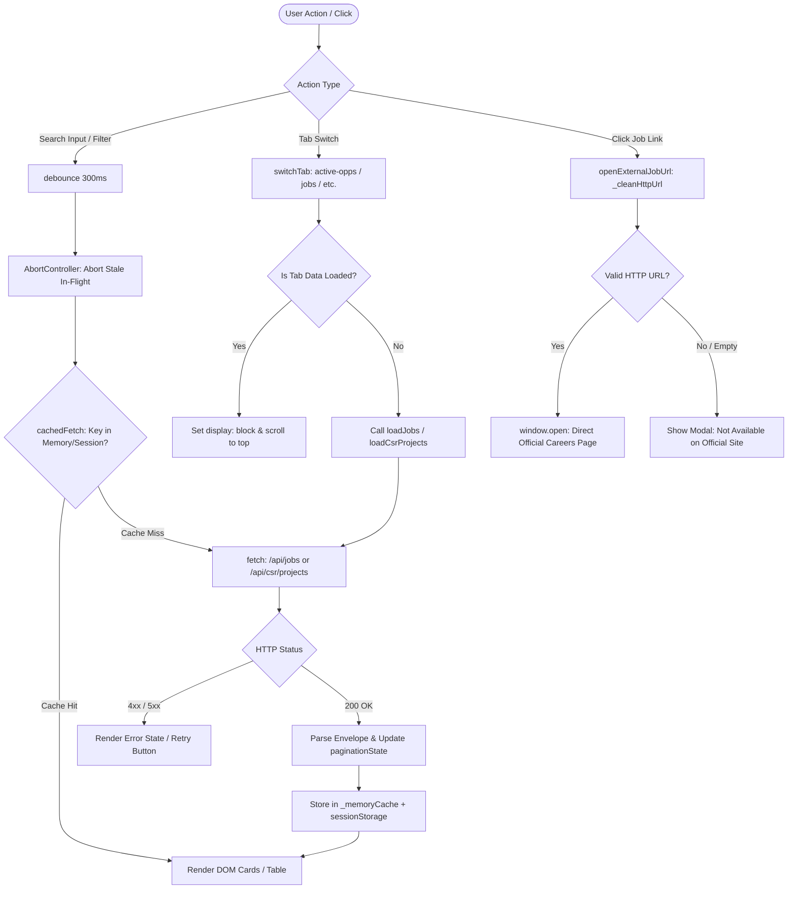

# 05. Frontend Architecture, UI/UX & JavaScript State Machine

**Frozen Timestamp:** `2026-10-29 12:12:48 +05:30`  
**Git Commit Hash:** `0a538883c17b40774c119deb78b9aaff72220606`

---

## 1. Master Template & Page Layouts

### PLAIN
The front end of the platform is designed as a responsive, high-speed single-page web portal. It loads an initial HTML frame styled with modern dark-mode enterprise UI standards (Tailwind CSS and custom design tokens), while all interactive tables, cards, search filters, and statistics are dynamically fetched and rendered by JavaScript. This allows users to search thousands of job openings, inspect CSR projects, view company profiles, and simulate subscriptions without full-page reloads.

### TECHNICAL
The primary client interface is defined in `templates/website/index.html` (2,051 lines) and powered by `static/js/app.js` (7,063 lines). The back office uses `templates/admin/base_admin.html` and `templates/admin/dashboard.html`.
- **Static Assets**:
  - Fonts: Locally hosted Plus Jakarta Sans and Inter WOFF2 files in `static/fonts/` (avoids render-blocking Google Font external network calls).
  - CSS: `static/css/style.css` (or minified `static/css/style.min.css`), loaded with `?v={{ STATIC_VERSION }}`.
  - JS: `static/js/app.js` (or minified `static/js/app.min.js`).

### Template Context & Conditional Rendering (`templates/website/index.html`)

| Section / Container ID | Data Rendered | Source Fields | Conditional Logic (`` / JS Guard) |
| :--- | :--- | :--- | :--- |
| `#telemetry-companies-count` | Monitored company count | `StatsSnapshot.total_companies` | Defaults to `200` until `/api/stats` responds. |
| `#header-wallet-balance-val` | Demo wallet balance | `Wallet.balance_paise` | Defaults to `₹0.00`; refreshed via `loadWalletBalance()`. |
| `#header-tier-label` | Subscription tier badge | `Subscription.plan.name` | Shows "Institutional Access" or plan name. |
| `#jobs-cards-container` | Job cards grid / table | `Job` serialized records | Evaluates `is_defective==false`. Displays "Not mentioned by source" if salary or experience is null. |
| `#csr-cards-container` | Statutory CSR projects | `CSRProject` records | Renders verbatim `raw_budget_text`. Suppresses unparseable numeric budgets. |
| `#active-opps-container` | Open grant/RFP calls | `CSROpportunity` records | Empty state rendered: "No verified open grant RFPs currently active." (100% synthetic rows quarantined). |
| `#company-directory-container`| Corporate profile cards | `Company` records | Evaluates `jobs_access` and `csr_access`. If `NOT_PUBLISHED`, badge displays "Restricted / Login Wall". |

---

## 2. JavaScript State Machine & Architecture (`static/js/app.js`)

### PLAIN
The JavaScript application manages all data in the user's browser without requiring page refreshes. When a user clicks a tab, types in a search bar, or selects a job category, the script filters data, manages pagination, and prevents duplicate network requests. To make searches snappy, it remembers previous search results for 30 seconds and automatically cancels older in-flight requests if the user types quickly.

### TECHNICAL
`static/js/app.js` is structured into functional modules:
1. **Central Pagination Store**:
   ```javascript
   const paginationState = {
       companies:       { page: 1, pageSize: 12, total: 0, totalPages: 1 },
       companyDirectory:{ page: 1, pageSize: 16, total: 0, totalPages: 1 },
       jobs:            { page: 1, pageSize: 12, total: 0, totalPages: 1 },
       findJobs:        { page: 1, pageSize: 12, total: 0, totalPages: 1 },
       companyJobs:     { page: 1, pageSize: 12, total: 0, totalPages: 1 },
       csr:             { page: 1, pageSize: 12, total: 0, totalPages: 1 },
       opps:            { page: 1, pageSize: 9,  total: 0, totalPages: 1 },
       crawler:         { page: 1, pageSize: 15, total: 0, totalPages: 1 }
   };
   ```
2. **High-Performance Fetch Wrapper (`cachedFetch`)**:
   - In-memory `Map` cache + `sessionStorage` backing (TTL: 30,000 ms).
   - In-flight request deduplication via `_inFlightRequests` Map.
   - `AbortController` cancellation: if a user types in a search box before the prior AJAX call completes, `cachedFetch` aborts the prior request using its signal.
3. **Tab Navigation Controller (`switchTab`)**:
   Supports 9 main views: `companies`, `jobs`, `csr-projects`, `active-opps`, `matching`, `prospects`, `coverage`, `crawler-logs`, `pricing`.

### Mermaid UX Navigation & Event Flowchart



---

## 3. URL Construction, Cleansing & Fallback Behavior

### PLAIN
When a user clicks "Apply Now" or "View CSR Report," the browser must open the genuine corporate page. If the scraped link was broken, malicious, or pointed to a search engine like Google or Bing, the system cleans the URL before opening it. If no valid link exists in the database, the button is disabled or opens a polite message stating that the company has not published a direct link.

### TECHNICAL
URL hygiene is handled by `_cleanHttpUrl(u)` in `static/js/app.js:442`:
```javascript
function _cleanHttpUrl(u) {
    if (!u || typeof u !== 'string') return null;
    const s = u.trim();
    if (!/^https?:\/\//i.test(s) || 
        s.toLowerCase().includes('google.com/search') || 
        s.toLowerCase().includes('bing.com/search')) {
        return null;
    }
    return s;
}
```
- **Job Application URLs (`application_url`)**:
  - Rendered in job cards as `<a href="..." target="_blank" rel="noopener noreferrer">`.
  - When `application_url` is verified HTTP 200, card displays a green `"Direct Verified Source"` pill.
  - When `application_url` equals `source_url` (landing page), card displays `"Careers Landing Portal"`.
- **Company CSR URLs (`csr_portal_url`)**:
  - Handled by `openCompanyCsr(companyId)`. If `csr_portal_url` is null, displays an inline modal: `"Statutory CSR portal link not disclosed by employer"`.
- **Company Careers URLs (`careers_url`)**:
  - Handled by `getCompanyWebsite(company)`. Resolves verified apex domain or ATS subdomain.

---

## 4. UI Components, Modals & Responsive Design

### 4.1 Executive Hamburger Menu Drawer
- On desktop screens, an executive drawer (opened via `#main-hamburger-btn`) houses secondary tools: Download Data Hub, CRM Prospecting Kanban, AI Settings, and Crawler Health Telemetry.
- On mobile devices (<1024px), the drawer transitions into a full-height touch sheet with touch backdrop dismissal.

### 4.2 Modal Windows
1. **Job Detail Modal (`#jobDetailModal`)**: Renders verbatim job descriptions, parsed responsibilities bullet lists, and live HTTP link verification buttons.
2. **CSR Detail Modal (`#csrDetailModal`)**: Displays project overview, Schedule VII statutory classifications, and district locations.
3. **Demo Wallet Top-Up Modal (`#walletTopupModal`)**: Allows users to enter test amounts to simulate institutional checkout and credit deduction.
4. **Subscription Plan Upgrade Modal (`#planUpgradeModal`)**: Renders transparent pricing cards with GST calculations.

### 4.3 Empty & Loading States
- **Loading Skeletons**: CSS-animated pulsating skeletons (`.skeleton-card`, `.skeleton-row`) occupy containers while AJAX requests are in flight.
- **Empty States**: If a filter yields zero matches, renders a dedicated empty-state illustration with a clear reset button (`clearAllFilters()`).

